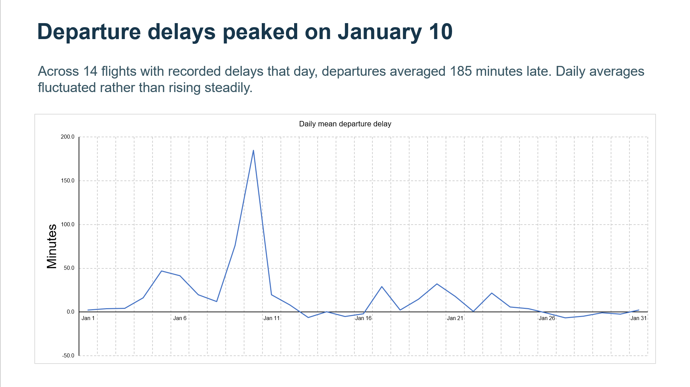
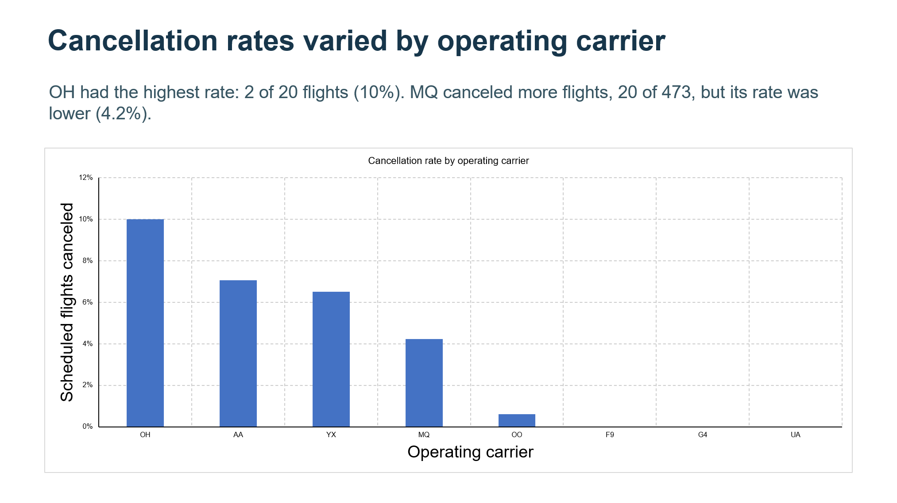
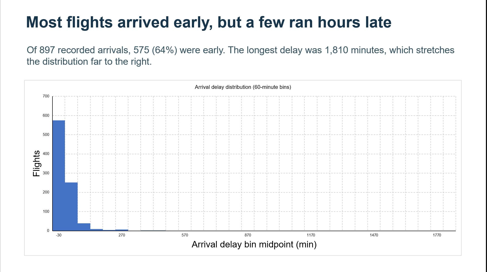
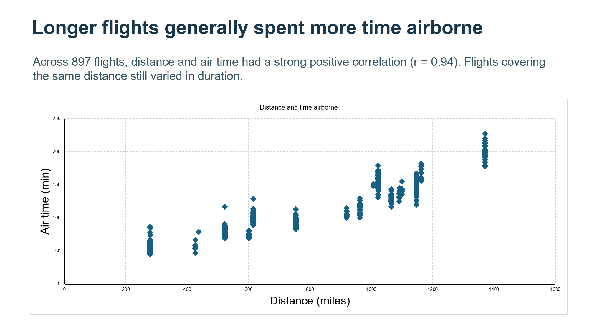

## Team Members

- \[Derek Camacho\] (<https://derek-c85.github.io/)>
- \[Easton Contorno\] (<https://ejc017.github.io/posts/xna-flight-delays/)>
- \[Josiah Cox\] ()
- \[Reese Martin\] (<https://reesemartin24.github.io/posts/Data%20Visualization/)>
- \[Isaac Shilling\]

## The Data Set

Our data comes form the US Department of Transportation's Bureau of Transportation Statistics, report of Carrier On-Time performance. We were able to pull this data fromn Janurary 2025 from the Airport near our school which had a data set of 933 flights. Each row is a flight and we inlcuded columns with dates, operating code, delay, arrival delay, cancellation, distance and air time. We pasted this data into excel and gave the columns names via information in the original data and cleaned it with AI to make the flight data sheets. Canceled flights dont have these values so we leave them out of calculations.

## Question 1: How did departure delays change over the month?

**Why it's interesting:** People traveling would want to know whether delays have a relation to certain days or are random. A spike can point to an outside cause, such as winter weather, rather than a consistent problem.

**How we used Excel:** On the Plots sheet, we grouped the 898 recorded departure delays by date and averaged them for each day. Negative values mean the flight left early.

**How the slide was developed:** Because this is about how the flight delays change over time, we used a line chart with zero shown to show when departures have clear outliers such as around the early weeks of january, and also shows negative numbers so the visual shows early departures.

## Question 2: Which carriers canceled the highest share of their flights?

**Why it's interesting:** The carrier with the most cancellations is not nessecarily the least reliable, because carriers fly different numbers of flights. Comparing rates instead of counts gives a fairer picture.

**How we used Excel:** For each carrier, we divided the number of cancellations by the number of scheduled departures (OH 20, AA 99, YX 92, MQ 473, OO 162, F9 4, G4 52, UA 31). We sorted the rates from highest to lowest and charted them as a bar chart.

**How the slide was developed:** A bar chart is the natural choice for this type of daya. We ordered the carrier from highest to lowest cancellation rates and put percentage on the axis. then added titles to the sides. This data is rather small sample size so we didnt make outrageous claims with it.

## Question 3: How late did flights usually arrive?

**Why it's interesting:** Averages can hide what most passengers actually experience. A distribution shows whether delays are common or whether a few extreme flights make the numbers look crazy

**How we used Excel:** We built a histogram of the 897 recorded arrival delays. We kept the empty bins and the largest delay (1,810 minutes) so the long tail stays visible. Flights with missing arrival delays were left out.

**How the slide was developed:** The title states that most flights arrived early but a few ran hours late, and the sentence gives the count (575 of 897, or 64%, arrived early). The histogram shows the tall bar near zero and the long stretch to the right.

## Question 4: Do longer flights spend more time in the air?

**Why it's interesting:** This checks whether the data behaves the way we would expect. It also shows the variance in airtime compared to distance between the flights covering the same distance.

**How we used Excel:** We paired distance (miles) with air time (minutes) for each of the 897 flights that had both values, made a scatter plot, and calculated the Pearson correlation which shows a strong positive correlation in r = 0.94

**How the slide was developed:** The best way to show these two variables is with a scatter plot with distacne on the x axis and air time on the Y. Each marker is one flight In the secondary sentence We noted the r value which allows us to make the conclusion in the title

